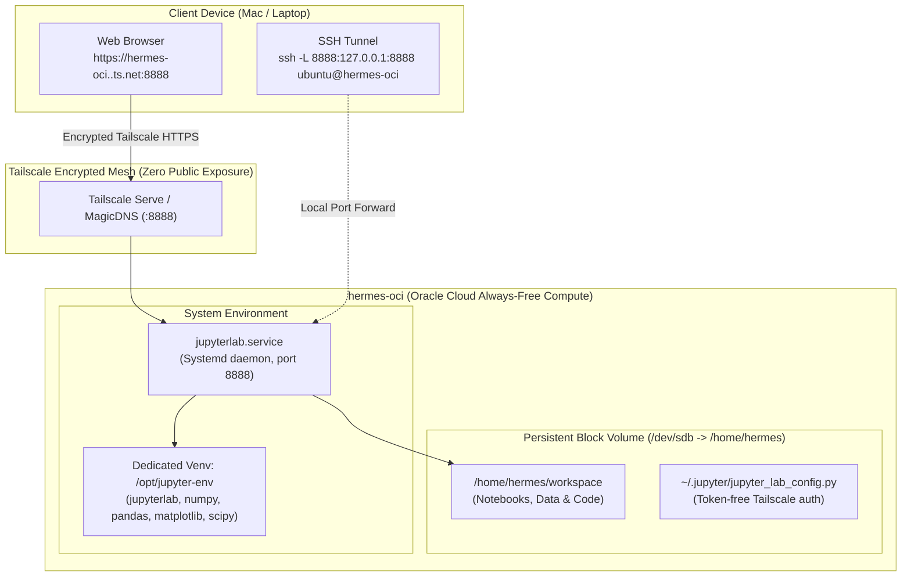

# JupyterLab Exploration Environment Guide

This guide provides instructions for installing, configuring, running, and accessing **JupyterLab** on your `hermes-oci` instance.

The environment is designed for interactive Python exploration, data analysis, and prototyping with direct access to your persistent workspace (`/home/hermes/workspace`) on the 100 GB block volume.

---

## Architecture & Security Boundary



### Key Highlights
- **Isolated Python Virtual Environment**: Installed at `/opt/jupyter-env` to avoid conflicts with system Python packages.
- **Persistent Workspace**: Opens directly into `/home/hermes/workspace`, so all your notebooks and data files reside on the persistent block volume and are covered by automated encrypted backups (`hermes-backup.sh`).
- **Tailscale Network Security**: Bound locally to `127.0.0.1` and proxied over Tailscale HTTPS. Zero ports are exposed to the public internet.
- **Token/Password-Free Access**: Because access is strictly gated behind your authenticated Tailscale VPN, access is seamless with 1 click.
- **Decoupled Installation**: The installation script sets up all packages and systemd configurations **without starting the service**, leaving you in full control of when it runs.

---

## 1. Automated Installation via `jupyter-setup.sh`

The installation script is available at `/usr/local/bin/jupyter-setup.sh` (or `scripts/jupyter-setup.sh` in this repository).

### Step 1: Run the Setup Script (Installation Only)
SSH into `hermes-oci`:
```bash
ssh ubuntu@hermes-oci
```

Run the installation script:
```bash
sudo /usr/local/bin/jupyter-setup.sh
```

This performs all setup actions:
1. Creates the Python virtual environment at `/opt/jupyter-env`.
2. Installs core exploration packages: `jupyterlab`, `notebook`, `ipykernel`, `ipywidgets`, `numpy`, `pandas`, `matplotlib`, `seaborn`, `scipy`.
3. Creates symlinks `/usr/local/bin/jupyter` and `/usr/local/bin/jupyter-lab`.
4. Writes `/home/hermes/.jupyter/jupyter_lab_config.py`.
5. Adds local and Tailscale iptables rules for port `8888`.
6. Configures Tailscale Serve for HTTPS on port `8888`.
7. Installs systemd service `/etc/systemd/system/jupyterlab.service`.

> [!NOTE]
> The setup script does **not** start the service automatically. You can start it whenever you are ready.

---

## 2. Managing the JupyterLab Service

Once installed, use standard systemd commands to manage the JupyterLab daemon:

### Start and Enable at Boot:
```bash
sudo systemctl enable --now jupyterlab.service
```

### Check Service Status:
```bash
sudo systemctl status jupyterlab.service
```

### Stop Service:
```bash
sudo systemctl stop jupyterlab.service
```

### Disable from Starting at Boot:
```bash
sudo systemctl disable jupyterlab.service
```

### Restart Service (e.g. after adding packages or configs):
```bash
sudo systemctl restart jupyterlab.service
```

### View Live Logs:
```bash
journalctl -u jupyterlab.service -f
```

---

## 3. Accessing the JupyterLab Web Interface

### Option A: Over Tailscale (Recommended)
If Tailscale is running on your client device and `hermes-oci`:

1. Verify Tailscale serve is configured on the VM:
   ```bash
   sudo tailscale serve --bg --https=8888 http://127.0.0.1:8888
   ```
2. Open your browser from any device on your Tailnet:
   👉 `https://hermes-oci.<your-tailnet-name>.ts.net:8888`
   *(or `http://<tailscale-ip>:8888`)*

No token or password prompt is required. You will be taken directly into JupyterLab.

### Option B: SSH Port Forwarding (Local Fallback)
From your local workstation terminal:
```bash
ssh -L 8888:127.0.0.1:8888 ubuntu@hermes-oci
```

Then navigate in your local browser to:
👉 `http://localhost:8888`

---

## 4. Manual Installation & Step-by-Step Configuration

If you prefer to configure the environment manually without using the script, follow these steps:

### Step 4.1: Create Dedicated Virtual Environment
```bash
sudo apt-get update
sudo apt-get install -y python3-venv python3-pip

# Create venv
sudo mkdir -p /opt/jupyter-env
sudo python3 -m venv /opt/jupyter-env

# Install JupyterLab and Data Science packages
sudo /opt/jupyter-env/bin/pip install --upgrade pip setuptools wheel
sudo /opt/jupyter-env/bin/pip install \
  jupyterlab notebook ipykernel ipywidgets \
  numpy pandas matplotlib seaborn scipy

# Symlink binaries
sudo ln -sf /opt/jupyter-env/bin/jupyter /usr/local/bin/jupyter
sudo ln -sf /opt/jupyter-env/bin/jupyter-lab /usr/local/bin/jupyter-lab
```

### Step 4.2: Configure JupyterLab Server
Create directory and config for user `hermes`:
```bash
sudo mkdir -p /home/hermes/.jupyter
sudo mkdir -p /home/hermes/workspace

sudo bash -c 'cat > /home/hermes/.jupyter/jupyter_lab_config.py' <<EOF
c = get_config()  # noqa

c.ServerApp.ip = "127.0.0.1"
c.ServerApp.port = 8888
c.ServerApp.port_retries = 0
c.ServerApp.open_browser = False
c.ServerApp.allow_remote_access = True
c.ServerApp.root_dir = "/home/hermes/workspace"

# Token/Password-free access on private Tailscale network
c.ServerApp.token = ""
c.ServerApp.password = ""
c.ServerApp.disable_check_xsrf = True

c.LabApp.default_url = "/lab"
EOF

sudo chown -R hermes:hermes /home/hermes/.jupyter
sudo chmod 700 /home/hermes/.jupyter
sudo chmod 600 /home/hermes/.jupyter/jupyter_lab_config.py
```

### Step 4.3: Configure Systemd Service
Create `/etc/systemd/system/jupyterlab.service`:
```ini
[Unit]
Description=JupyterLab Exploration Environment
After=network.target

[Service]
Type=simple
User=hermes
Group=hermes
WorkingDirectory=/home/hermes/workspace
Environment=HOME=/home/hermes
Environment=PATH=/opt/jupyter-env/bin:/home/hermes/.local/bin:/usr/local/bin:/usr/bin:/bin
ExecStart=/opt/jupyter-env/bin/jupyter lab --config=/home/hermes/.jupyter/jupyter_lab_config.py
Restart=always
RestartSec=5
LimitNOFILE=65536

[Install]
WantedBy=multi-user.target
```

Reload systemd:
```bash
sudo systemctl daemon-reload
```

### Step 4.4: Firewall & Tailscale Routing
```bash
# Allow port 8888 on loopback and tailscale0 interface only
sudo iptables -C INPUT -i lo -p tcp --dport 8888 -j ACCEPT 2>/dev/null || sudo iptables -I INPUT -i lo -p tcp --dport 8888 -j ACCEPT
sudo iptables -C INPUT -i tailscale0 -p tcp --dport 8888 -j ACCEPT 2>/dev/null || sudo iptables -I INPUT -i tailscale0 -p tcp --dport 8888 -j ACCEPT
sudo netfilter-persistent save

# Expose via Tailscale Serve
sudo tailscale serve --bg --https=8888 http://127.0.0.1:8888
```

---

## 5. Adding & Managing Python Packages

You can install additional libraries and packages into your environment using any of the following approaches depending on your workflow.

---

### Method A: Directly from a Notebook Cell (Recommended for Exploration)

You can install packages on the fly without leaving JupyterLab or opening an SSH terminal by using the **`%pip`** magic command inside any notebook code cell:

```python
# In a Jupyter notebook cell:
%pip install scikit-learn httpx rich
```

> [!TIP]
> Always use `%pip install` rather than `!pip install`. The `%pip` magic command guarantees that packages are installed into the exact virtual environment powering the active notebook kernel, even if system PATH differs.

Once the cell completes execution, you can immediately import and use the library in subsequent cells without restarting the JupyterLab service or server:

```python
import httpx
response = httpx.get("https://api.github.com")
print(response.status_code)
```

---

### Method B: Via SSH Terminal (`/opt/jupyter-env`)

To install packages from your terminal into the shared exploration environment:

```bash
# SSH into hermes-oci as ubuntu
ssh ubuntu@hermes-oci

# Install one or more packages
sudo /opt/jupyter-env/bin/pip install <package-name>
```

#### Common Curated Package Bundles:

* **Machine Learning & Modeling**:
  ```bash
  sudo /opt/jupyter-env/bin/pip install scikit-learn statsmodels
  ```
* **High-Performance Data & Analytics**:
  ```bash
  sudo /opt/jupyter-env/bin/pip install polars duckdb pyarrow
  ```
* **Interactive & Web Visualizations**:
  ```bash
  sudo /opt/jupyter-env/bin/pip install plotly altair bokeh
  ```
* **Networking, APIs & Scraping**:
  ```bash
  sudo /opt/jupyter-env/bin/pip install httpx aiohttp beautifulsoup4 pydantic
  ```
* **From a `requirements.txt` file**:
  ```bash
  sudo /opt/jupyter-env/bin/pip install -r /home/hermes/workspace/my-project/requirements.txt
  ```

---

### Method C: Using the JupyterLab Built-in Web Terminal

JupyterLab includes a built-in terminal that runs directly in your browser:

1. In the JupyterLab menu, select **File** → **New** → **Terminal** (or click the **Terminal** icon in the Launcher).
2. The terminal opens directly in your workspace. You can run `pip` commands:
   ```bash
   pip install --user <package-name>
   # or into the main venv:
   /opt/jupyter-env/bin/pip install --user <package-name>
   ```

---

### Method D: Project-Specific Virtual Environments (Multiple Kernels)

If you have a project with pinned dependency versions or conflicting requirements that you don't want to mix with the global exploration environment, you can create a dedicated virtual environment inside your project folder and register it as an independent **Jupyter Kernel**:

#### 1. Create the project venv:
```bash
cd /home/hermes/workspace
mkdir -p my-analysis && cd my-analysis
python3 -m venv .venv
```

#### 2. Install `ipykernel` and project dependencies:
```bash
./.venv/bin/pip install --upgrade pip
./.venv/bin/pip install ipykernel polars plotly
```

#### 3. Register the kernel with Jupyter:
```bash
./.venv/bin/python -m ipykernel install --user --name my-analysis --display-name "Python (My Analysis)"
```

#### 4. Use in JupyterLab:
* Reload or open JupyterLab.
* When creating a new notebook, select **Python (My Analysis)** from the kernel launcher.
* For an existing notebook, click the kernel name in the upper-right corner and select **Python (My Analysis)** from the dropdown.

#### To list or remove custom kernels later:
```bash
# List all registered kernels
jupyter kernelspec list

# Remove a custom kernel
jupyter kernelspec uninstall my-analysis
```

---

### Method E: Installing Packages with System/C Library Dependencies

Some Python packages require underlying Linux shared libraries or compilers before `pip` can install or compile them. Install the required system packages via `apt` first:

| Python Package | Required Ubuntu System Packages | Command |
|---|---|---|
| **`psycopg2` / PostgreSQL client** | `libpq-dev`, `python3-dev` | `sudo apt-get install -y libpq-dev python3-dev` |
| **`pygraphviz`** | `graphviz`, `libgraphviz-dev` | `sudo apt-get install -y graphviz libgraphviz-dev` |
| **`opencv-python`** | `libgl1`, `libglib2.0-0` | `sudo apt-get install -y libgl1 libglib2.0-0` |
| **`Pillow` (advanced image formats)** | `libjpeg-dev`, `zlib1g-dev`, `libfreetype6-dev` | `sudo apt-get install -y libjpeg-dev zlib1g-dev libfreetype6-dev` |

Once the system packages are installed, install the Python package as normal:
```bash
sudo /opt/jupyter-env/bin/pip install psycopg2-binary
```

---

## 6. Troubleshooting

| Symptom | Cause | Solution |
|---|---|---|
| **Connection Refused on port 8888** | Service is not running | Run `sudo systemctl status jupyterlab.service` and start it with `sudo systemctl start jupyterlab.service` |
| **Tailscale serve returns 502** | JupyterLab backend stopped or port mismatch | Verify JupyterLab is listening with `sudo ss -tulpn \| grep 8888` and restart service |
| **Permission denied in `/home/hermes/workspace`** | Files owned by root | Run `sudo chown -R hermes:hermes /home/hermes/workspace` |
| **Port 8888 already in use** | Stray process | Run `sudo lsof -i :8888` and terminate the orphaned process |
