# Piston Code Execution Engine on OCI Hermes

This document provides a comprehensive operational guide and step-by-step setup for running the **Piston** code execution engine ([piyushpatel2005/piston](https://github.com/piyushpatel2005/piston)) on your OCI VM (`hermes-oci`), securely accessible to `platform-workers` in `intercourses/`.

---

## 1. Architecture & Design Principles

```mermaid
flowchart LR
    subgraph Browser["Student Browser / Client"]
        UI["intercourses Code Editor"]
    end

    subgraph Edge["Cloudflare Workers (platform-workers)"]
        Auth["1. Validate Auth Token / Session"]
        RateLimit["2. Rate Limit (e.g. 5 req/min per user)"]
        Sanitize["3. Sanitize Payload & Caps\n(Enforce timeouts; block /packages)"]
        Auth --> RateLimit --> Sanitize
    end

    subgraph Cloudflare["Cloudflare Network"]
        Tunnel["Cloudflare Tunnel (Outbound)"]
    end

    subgraph OCI["OCI VM (agentic-infra)"]
        Cloudflared["cloudflared daemon"]
        Piston["Piston Container (piston-api:local)\n127.0.0.1:2000"]
        Cloudflared --> Piston
    end

    UI -- "POST /api/execute" --> Auth
    Sanitize -- "HTTPS + X-Piston-Proxy-Secret" --> Tunnel
    Tunnel --> Cloudflared
```



1. **100% Self-Contained Local Build**:
   * Compiles natively from the repository's local [`api/Dockerfile`](https://github.com/piyushpatel2005/piston/tree/master/api) into a local image (`piston-api:local`).
   * **No reliance on `ghcr.io/engineer-man/piston`**: If upstream removes or updates their image, your deployment remains fully functional.
   * Compiles `isolate` and dependencies natively for **ARM64** on OCI's Ampere A1 shape.
2. **Zero Inbound Ports on OCI Firewall**:
   * Piston binds to `127.0.0.1:2000` (loopback).
   * OCI Security Lists and Network Security Groups (NSGs) remain completely closed to inbound HTTP/API traffic (SSH only).
   * Connectivity from `platform-workers` is established via an encrypted outbound **Cloudflare Tunnel (`cloudflared`)**.
3. **Defense-in-Depth Authentication**:
   * Unauthenticated visitors are rejected at the edge with `401 Unauthorized` by your Cloudflare Worker.
   * Direct access bypassing the worker is blocked via Cloudflare WAF using a shared secret header (`X-Piston-Proxy-Secret`).
   * Administrative routes (`/api/v2/packages`) are strictly forbidden to public clients.

---

## 2. Step-by-Step Piston Setup

### Option A: Automated Setup (Recommended)

The VM deployment script automates package installation, source checkout, Buster repository patching, ARM64 compilation, and systemd service registration.

```bash
# 1. SSH into the VM as ubuntu
ssh ubuntu@hermes-oci

# 2. Run the setup script (clones repo, builds piston-api:local, and starts service)
sudo /usr/local/bin/piston-setup.sh --start
```

---

### Option B: Manual Setup Walkthrough

If you want to configure or verify each step manually:

#### Step 1: Install Docker and Docker Compose
```bash
sudo apt-get update -qq
sudo apt-get install -y -qq docker.io docker-compose-v2
sudo systemctl enable --now docker.service
sudo usermod -aG docker ubuntu
sudo usermod -aG docker hermes
```

#### Step 2: Clone Your Piston Fork
```bash
sudo mkdir -p /opt/piston
sudo git clone --depth 1 https://github.com/piyushpatel2005/piston.git /opt/piston
sudo mkdir -p /opt/piston/data/piston/packages
sudo chmod -R 755 /opt/piston/data
```

#### Step 3: Configure Self-Contained Build in `docker-compose.yaml`
Ensure `/opt/piston/docker-compose.yaml` points to `build: api` and uses the local image `piston-api:local`:

```yaml
version: '3.2'

services:
    api:
        build: api
        image: piston-api:local
        container_name: piston_api
        restart: always
        privileged: true
        ports:
            - "127.0.0.1:2000:2000"
        volumes:
            - ./data/piston/packages:/piston/packages
        tmpfs:
            - /tmp:exec
        environment:
            - PISTON_BIND_ADDRESS=0.0.0.0:2000
            - PISTON_RUN_TIMEOUT=15000
            - PISTON_COMPILE_TIMEOUT=15000
```

#### Step 4: Patch `api/Dockerfile` for Debian Buster Archive Repositories
Because Debian Buster reached end-of-life, point `api/Dockerfile` apt sources to `archive.debian.org` before building:

```bash
sudo python3 -c "
path = '/opt/piston/api/Dockerfile'
content = open(path).read()
if 'archive.debian.org' not in content:
    patch = 'RUN sed -i \"s/deb.debian.org/archive.debian.org/g\" /etc/apt/sources.list && sed -i \"s|security.debian.org/debian-security|archive.debian.org/debian-security|g\" /etc/apt/sources.list && sed -i \"/buster-updates/d\" /etc/apt/sources.list && apt-get update'
    content = content.replace('RUN apt-get update', patch)
    open(path, 'w').write(content)
"
```

#### Step 5: Build the ARM64 Image from Source
```bash
cd /opt/piston
sudo docker compose build
```

#### Step 6: Start Piston Container
```bash
cd /opt/piston
sudo docker compose up -d
```

#### Step 7: Verify Service Health
```bash
curl -s http://127.0.0.1:2000/api/v2/runtimes
```
*(Returns `[]` or a JSON list of installed runtimes).*

---

## 3. Installing & Managing Language Runtimes

Language runtimes persist in `/opt/piston/data/piston/packages` on the VM's host filesystem across container restarts and rebuilds.

### Install Default Language Runtimes
Run these requests from the VM to install runtimes required by `intercourses`:

```bash
# Python 3.12
curl -X POST http://127.0.0.1:2000/api/v2/packages \
  -H 'Content-Type: application/json' \
  -d '{"language":"python","version":"3.12.0"}'

# Node.js (JavaScript)
curl -X POST http://127.0.0.1:2000/api/v2/packages \
  -H 'Content-Type: application/json' \
  -d '{"language":"node","version":"20.11.1"}'

# Go
curl -X POST http://127.0.0.1:2000/api/v2/packages \
  -H 'Content-Type: application/json' \
  -d '{"language":"go","version":"1.16.2"}'

# Java (OpenJDK 15)
# Note: On ARM64 hosts, piston-setup.sh automatically provisions native OpenJDK 15.0.2

# Rust
curl -X POST http://127.0.0.1:2000/api/v2/packages \
  -H 'Content-Type: application/json' \
  -d '{"language":"rust","version":"1.68.2"}'
```

### Adding New Packages or Updated Versions
Because you have your own fork [`piyushpatel2005/piston`](https://github.com/piyushpatel2005/piston):
1. Add new language recipes in the [`packages/`](https://github.com/piyushpatel2005/piston/tree/master/packages) directory (e.g. `packages/python/3.13.0/build.sh`).
2. Build or test packages locally on the host using the CLI:
   ```bash
   cd /opt/piston/cli
   node index.js -p <language> -v <version>
   ```

---

## 4. Multi-File Code Execution Examples

Piston natively supports multi-file code execution across programming languages using the `files` array.

### Core Rules for Multi-File Execution:
1. **Entrypoint First**: The first object in the `files` array is treated as the execution entrypoint.
2. **Automatic Directory Creation**: Paths with forward slashes (e.g. `"utils/math.py"` or `"calc/calc.go"`) automatically create subdirectories inside the sandbox.
3. **Data & Config Files**: You can pass non-code files (e.g. `config.json`, `data.csv`, `go.mod`, `package.json`) in the `files` array, and your code can read them directly at runtime.

---

### 1. Python Multi-File (`main.py` + `helper.py` + Subpackages)

```bash
curl -s -X POST http://127.0.0.1:2000/api/v2/execute \
  -H 'Content-Type: application/json' \
  -d '{
    "language": "python",
    "version": "3.12.0",
    "files": [
      {
        "name": "main.py",
        "content": "import helper\nfrom utils.math import multiply\n\nprint(helper.greet(\"Student\"))\nprint(\"Multiply result:\", multiply(6, 7))\n"
      },
      {
        "name": "helper.py",
        "content": "def greet(name):\n    return f\"Hello, {name} from helper.py!\"\n"
      },
      {
        "name": "utils/math.py",
        "content": "def multiply(a, b):\n    return a * b\n"
      }
    ]
  }' | jq .
```

---

### 2. JavaScript / Node.js Multi-File (`index.js` + `calculator.js`)

```bash
curl -s -X POST http://127.0.0.1:2000/api/v2/execute \
  -H 'Content-Type: application/json' \
  -d '{
    "language": "javascript",
    "version": "20.11.1",
    "files": [
      {
        "name": "index.js",
        "content": "const { add, multiply } = require(\"./calculator\");\nconsole.log(\"Sum:\", add(10, 5));\nconsole.log(\"Product:\", multiply(10, 5));\n"
      },
      {
        "name": "calculator.js",
        "content": "exports.add = (a, b) => a + b;\nexports.multiply = (a, b) => a * b;\n"
      }
    ]
  }' | jq .
```

---

### 3. Go Multi-File

#### Pattern A: Same Package (`package main`)
```bash
curl -s -X POST http://127.0.0.1:2000/api/v2/execute \
  -H 'Content-Type: application/json' \
  -d '{
    "language": "go",
    "version": "1.16.2",
    "files": [
      {
        "name": "main.go",
        "content": "package main\n\nimport \"fmt\"\n\nfunc main() {\n    fmt.Println(Greet(\"Student\"))\n}\n"
      },
      {
        "name": "helper.go",
        "content": "package main\n\nfunc Greet(name string) string {\n    return \"Hello, \" + name + \" from helper.go!\"\n}\n"
      }
    ]
  }' | jq .
```

#### Pattern B: With `go.mod` and Subpackages
```bash
curl -s -X POST http://127.0.0.1:2000/api/v2/execute \
  -H 'Content-Type: application/json' \
  -d '{
    "language": "go",
    "version": "1.16.2",
    "files": [
      {
        "name": "main.go",
        "content": "package main\n\nimport (\n    \"fmt\"\n    \"example/calc\"\n)\n\nfunc main() {\n    fmt.Println(\"Sum:\", calc.Add(10, 20))\n}\n"
      },
      {
        "name": "go.mod",
        "content": "module example\n\ngo 1.16\n"
      },
      {
        "name": "calc/calc.go",
        "content": "package calc\n\nfunc Add(a, b int) int {\n    return a + b\n}\n"
      }
    ]
  }' | jq .
```

---

### 4. Java Multi-File (`Main.java` + `Calculator.java`)

```bash
curl -s -X POST http://127.0.0.1:2000/api/v2/execute \
  -H 'Content-Type: application/json' \
  -d '{
    "language": "java",
    "version": "15.0.2",
    "files": [
      {
        "name": "Main.java",
        "content": "public class Main {\n    public static void main(String[] args) {\n        Calculator c = new Calculator();\n        System.out.println(\"Java Multi-File Result: \" + c.add(40, 2));\n    }\n}"
      },
      {
        "name": "Calculator.java",
        "content": "public class Calculator {\n    public int add(int a, int b) {\n        return a + b;\n    }\n}"
      }
    ]
  }' | jq .
```

---

### 5. Rust (`main.rs`)

```bash
curl -s -X POST http://127.0.0.1:2000/api/v2/execute \
  -H 'Content-Type: application/json' \
  -d '{
    "language": "rust",
    "version": "1.68.2",
    "files": [
      {
        "name": "main.rs",
        "content": "fn main() {\n    println!(\"Rust ARM64 Execution Success!\");\n}\n"
      }
    ]
  }' | jq .
```

---

### 6. Reading External Data Files (e.g. `data.csv` or `config.json`)

You can include data files directly in `files` for course exercises that process files:

```bash
curl -s -X POST http://127.0.0.1:2000/api/v2/execute \
  -H 'Content-Type: application/json' \
  -d '{
    "language": "python",
    "version": "3.12.0",
    "files": [
      {
        "name": "main.py",
        "content": "import json\n\nwith open(\"config.json\") as f:\n    cfg = json.load(f)\n\nprint(f\"Loaded Course: {cfg[\x27course\x27]} (Level: {cfg[\x27level\x27]})\")\n"
      },
      {
        "name": "config.json",
        "content": "{\n  \"course\": \"Distributed Systems\",\n  \"level\": \"Advanced\"\n}\n"
      }
    ]
  }' | jq .
```

---

## 5. Systemd Service Management

Piston is managed via systemd unit `piston.service`:

```bash
# Check status
sudo systemctl status piston.service

# View live container logs
cd /opt/piston && sudo docker compose logs -f

# Restart Piston
sudo systemctl restart piston.service

# Stop Piston
sudo systemctl stop piston.service
```

---

## 6. Connecting `platform-workers` via Cloudflare Tunnel (Multi-Node Load Balancing)

You can run multiple OCI instances (e.g. two 2-OCPU / 12 GB RAM instances under OCI Always Free tier) behind Cloudflare Tunnels without any public inbound ports.

### Step 1: Establish Hostname Naming Convention
Assign a distinct public hostname to each OCI VM:
* **Node 1**: `piston-1.internal.yourdomain.com`
* **Node 2**: `piston-2.internal.yourdomain.com`
* **Node N**: `piston-N.internal.yourdomain.com`

### Step 2: Create Tunnels in Cloudflare Zero Trust Dashboard
1. Go to [Cloudflare Dashboard](https://dash.cloudflare.com/) → **Zero Trust** → **Networks** → **Tunnels**.
2. Click **Create a Tunnel** (e.g. `piston-node-1` for VM 1 and `piston-node-2` for VM 2).
3. Select **Debian ARM64** and copy the install token (`eyJhIjoi...`).
4. In the **Public Hostname** tab:
   * **Subdomain**: `piston-1.internal` (or `piston-2.internal`)
   * **Domain**: `yourdomain.com`
   * **Type**: `HTTP`
   * **URL**: `127.0.0.1:2000`
5. Click **Save Hostname**.

### Step 3: Install Tunnel Daemon on Each OCI VM
```bash
# On OCI VM 1:
sudo /usr/local/bin/piston-setup.sh --tunnel-token <TOKEN_FOR_NODE_1>

# On OCI VM 2:
sudo /usr/local/bin/piston-setup.sh --tunnel-token <TOKEN_FOR_NODE_2>
```

### Step 4: Configure Cloudflare WAF Wildcard Shared Secret Rule
In Cloudflare Dashboard → Domain → **Security** → **WAF (Custom Rules)**:
* **Rule Name**: Require Piston Proxy Secret
* **Filter Expression**:
  ```text
  (http.host contains "piston-" and http.request.headers["x-piston-proxy-secret"][0] ne "<YOUR_SECRET_TOKEN>")
  ```
* **Action**: **Block**

---

## 7. `platform-workers` Implementation Guide

Add the following execution handler in your Cloudflare Worker (`intercourses/platform/api-worker`), which automatically balances traffic across all configured nodes with single-hop failover:

```typescript
export interface Env {
  PISTON_ENDPOINTS?: string;      // Comma-separated: "https://piston-1.internal.example.com,https://piston-2.internal.example.com"
  PISTON_INTERNAL_URL?: string;   // Fallback single endpoint
  PISTON_PROXY_SECRET: string;    // Shared secret token configured in Cloudflare WAF rule
}

export function getPistonEndpoints(env: Env): string[] {
  const raw = env.PISTON_ENDPOINTS || env.PISTON_INTERNAL_URL || "http://127.0.0.1:2000";
  return raw.split(",").map(url => url.trim().replace(/\/$/, "")).filter(Boolean);
}

export async function handleCodeExecution(request: Request, env: Env): Promise<Response> {
  // 1. Verify Authentication using your existing auth worker logic
  const user = await authenticateUser(request, env);
  if (!user) {
    return new Response(JSON.stringify({ error: "Unauthorized" }), { 
      status: 401,
      headers: { "Content-Type": "application/json" }
    });
  }

  // 2. Per-User Rate Limiting (e.g. 10 executions per minute per user)
  const rateLimitKey = `piston:ratelimit:${user.id}`;
  // (Use Cloudflare Rate Limiting or KV check here)

  // 3. Parse and validate JSON payload
  let payload: any;
  try {
    payload = await request.json();
  } catch {
    return new Response(JSON.stringify({ error: "Invalid JSON payload" }), { status: 400 });
  }

  const { language, version, files, stdin, args } = payload;
  if (!language || !Array.isArray(files) || files.length === 0) {
    return new Response(JSON.stringify({ error: "Missing required fields (language, files)" }), { 
      status: 400 
    });
  }

  // 4. Sanitize and enforce hard limits (ignore client-supplied overrides)
  const sanitizedPayload = {
    language,
    version: version || "*",
    files: files.slice(0, 5).map((f: { name?: string; content: string }) => ({
      name: f.name || "main",
      content: String(f.content).slice(0, 65536) // Cap source at 64 KB
    })),
    stdin: stdin ? String(stdin).slice(0, 8192) : "",
    args: Array.isArray(args) ? args.slice(0, 10) : [],
    run_timeout: 5000,          // 5 seconds max runtime
    compile_timeout: 10000,     // 10 seconds max compile time
    run_memory_limit: 128 * 1024 * 1024 // 128 MB RAM max
  };

  // 5. Edge Load Balancing & Single-Hop Failover Across Piston Nodes
  const nodes = getPistonEndpoints(env);
  const startIndex = Math.floor(Math.random() * nodes.length);
  const maxAttempts = Math.min(nodes.length, 2);

  for (let attempt = 0; attempt < maxAttempts; attempt++) {
    const targetNode = nodes[(startIndex + attempt) % nodes.length];
    const pistonEndpoint = `${targetNode}/api/v2/execute`;

    try {
      const response = await fetch(pistonEndpoint, {
        method: "POST",
        headers: {
          "Content-Type": "application/json",
          "X-Piston-Proxy-Secret": env.PISTON_PROXY_SECRET
        },
        body: JSON.stringify(sanitizedPayload),
        signal: AbortSignal.timeout(12000)
      });

      if (response.ok) {
        const result = await response.json();
        return new Response(JSON.stringify(result), {
          status: 200,
          headers: { 
            "Content-Type": "application/json",
            "Access-Control-Allow-Origin": "https://your-intercourses-domain.com"
          }
        });
      }

      // Retry next node if primary returned server error
      if (response.status >= 502 && attempt < maxAttempts - 1) {
        continue;
      }

      const errText = await response.text();
      return new Response(JSON.stringify({ error: `Node error: ${response.status}`, details: errText }), {
        status: response.status,
        headers: { "Content-Type": "application/json" }
      });
    } catch (err: any) {
      if (attempt < maxAttempts - 1) {
        continue;
      }
      return new Response(JSON.stringify({ error: "Execution cluster unavailable" }), { 
        status: 503,
        headers: { "Content-Type": "application/json" }
      });
    }
  }

  return new Response(JSON.stringify({ error: "All execution nodes failed" }), { 
    status: 503,
    headers: { "Content-Type": "application/json" }
  });
}
```

---

## 8. Node Failure & Replacement Runbook (Disaster Recovery)

If an OCI instance experiences hardware termination, OS corruption, or is replaced, you can restore full capacity in minutes with **zero application code changes and zero student downtime**.

### How Failover Protects You
* **Automatic Cloudflare Worker Failover**: While Node 1 is offline, the failover logic in `platform/api-worker` automatically retries and routes 100% of student execution requests to the remaining healthy node (e.g. Node 2).
* **Decoupled DNS via Tunnels**: The public hostname (e.g. `piston-1.internal.yourdomain.com`) is bound to the **Tunnel in Cloudflare Zero Trust**, not the physical IP address of the VM.
* **No Code / Config Edits**: You do **not** need to update DNS records or modify `PISTON_ENDPOINTS` in the worker.

---

### Step-by-Step Replacement Procedure:

#### 1. Provision the Replacement OCI VM
* In OCI Console: **Compute** → **Instances** → **Create Instance**:
  * **Shape**: Ampere `VM.Standard.A1.Flex` (2 OCPUs, 12 GB RAM)
  * **Image**: Ubuntu 24.04 LTS (Noble) Minimal ARM64
  * *(Or run `terraform apply` in `agentic-infra/terraform`)*.

#### 2. Rebuild Piston & Provision Runtimes
SSH into the replacement VM and run the automated setup:
```bash
# 1. SSH into the new VM
ssh ubuntu@<NEW_INSTANCE_IP>

# 2. Run automated self-contained deployment
sudo /usr/local/bin/piston-setup.sh --start
```
*This compiles `piston-api:local` natively for ARM64, registers the `piston.service` systemd unit on loopback `127.0.0.1:2000`, and installs all 5 native ARM64 runtimes (Python 3.12, Node 20.11, Go 1.16, Java 15.0.2, and Rust 1.68.2).*

#### 3. Re-attach the Existing Cloudflare Tunnel
Do **not** create a new tunnel or delete the old one. Re-attach the connector to the existing tunnel:
1. Open [Cloudflare Zero Trust](https://dash.cloudflare.com/) → **Networks** → **Tunnels**.
2. Click on the existing tunnel for this node (e.g. `piston-node-1`).
3. Under **Configure** → **Overview**, select **Debian ARM64**, and copy the tunnel token.
4. Run on the new VM:
   ```bash
   ARCH=$(dpkg --print-architecture)
   curl -fsSL "https://github.com/cloudflare/cloudflared/releases/latest/download/cloudflared-linux-${ARCH}.deb" -o /tmp/cloudflared.deb
   sudo dpkg -i /tmp/cloudflared.deb
   rm -f /tmp/cloudflared.deb

   # Install tunnel service using existing token
   sudo cloudflared service install <YOUR_EXISTING_TOKEN>
   sudo systemctl restart cloudflared
   ```
5. In Cloudflare Dashboard, the tunnel status will switch to **Healthy** (Active).

#### 4. Verify Node Restoration
```bash
# Check local engine
curl -s http://127.0.0.1:2000/api/v2/runtimes | jq .

# Check end-to-end execution through tunnel
curl -s -X POST https://piston-1.internal.yourdomain.com/api/v2/execute \
  -H "Content-Type: application/json" \
  -H "X-Piston-Proxy-Secret: <YOUR_SECRET_TOKEN>" \
  -d '{"language":"python","version":"3.12.0","files":[{"name":"main.py","content":"print(\"Node 1 Restored!\")"}]}' | jq .
```

The node is immediately returned to active load-balanced rotation!

---

## 9. Troubleshooting Checklist

| Symptom | Cause | Solution |
| :--- | :--- | :--- |
| **`400 Language not found`** | Language package not installed yet | Install via `POST /api/v2/packages` on the VM. Verify installed packages with `GET /api/v2/runtimes`. |
| **`docker compose build` fails with 404** | Debian Buster repositories moved to archive | Ensure `api/Dockerfile` uses `archive.debian.org` (automated in Step 4). |
| **Worker returns `502 Bad Gateway`** | `cloudflared` is down or wrong target port | Verify `sudo systemctl status cloudflared` on OCI and confirm the tunnel targets `http://127.0.0.1:2000`. |
| **Worker returns `403 Forbidden`** | Missing or incorrect proxy secret header | Verify that `X-Piston-Proxy-Secret` in your Worker matches the Cloudflare WAF rule. |
| **Container port collision on restart** | Old container or duplicate port declaration | Run `sudo docker rm -f piston_api` and ensure ports are mapped as `"127.0.0.1:2000:2000"` in `docker-compose.yaml`. |
