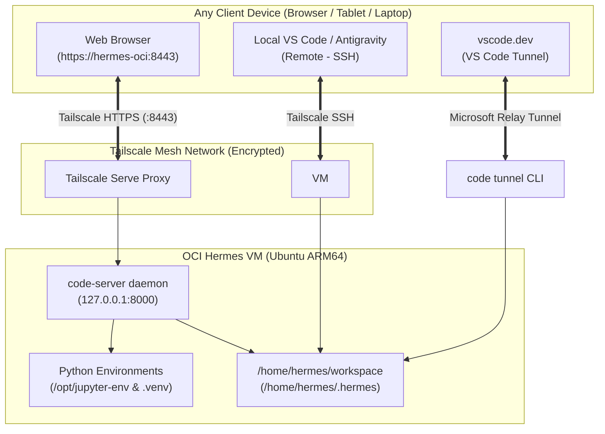

# Remote Coding & File Editing on OCI Hermes

This guide explains how to code, browse, and edit files located on your remote OCI Hermes VM from **any device** using browser-based **Web VS Code**, **VS Code Tunnels**, or local **VS Code / Antigravity** via SSH.

It also details how to execute interactive **Jupyter Notebooks (`.ipynb`)** directly inside VS Code without running a separate JupyterLab server.

---

## Architecture Overview

All web services and SSH endpoints are protected behind your private **Tailscale mesh network**. No public ports are exposed to the internet.



---

## Method 1: Web VS Code via Browser (Recommended for Any Device)

`code-server` runs continuously as a background systemd service on your VM and is served securely over Tailscale HTTPS on port **8443**.

### 1. Access the Editor:
Open your browser on any device connected to your Tailnet (laptop, iPad, Chromebook, phone) and navigate to:
👉 **`https://hermes-oci.<your-tailnet>.ts.net:8443`**

*(No password is required when accessed over Tailscale; only authenticated members of your Tailnet can connect).*

### 2. Features:
* **Full VS Code UI in the browser**: Integrated terminal, file explorer, git staging, search & replace, and extensions.
* **Workspace pre-loaded**: Opens directly in `/home/hermes/workspace` (or `/home/hermes`).
* **Pre-installed Python & Jupyter Extensions**: Ready for data exploration and notebook execution out of the box.

### 3. Managing the Service:
```bash
# Check status
sudo systemctl status code-server.service

# Restart service
sudo systemctl restart code-server.service

# Stop / Disable service
sudo systemctl stop code-server.service
sudo systemctl disable code-server.service
```

### 4. Configuration:
The configuration file is located at `/home/hermes/.config/code-server/config.yaml`:
```yaml
bind-addr: 127.0.0.1:8000
auth: none
cert: false
```
To require a password in addition to Tailscale, set `auth: password` and add `password: your-secret-password`.

---

## Running Jupyter Notebooks (`.ipynb`) in VS Code

Because VS Code has native interactive notebook support and the **Python** and **Jupyter** extensions are pre-installed in `code-server`, you do not need a separate JupyterLab web service.

### How to use:
1. Open or create any `.ipynb` file in VS Code or `code-server`.
2. Click **Select Kernel** in the top-right corner of the notebook editor.
3. Choose **Python Environments...**:
   * **Global Exploration Environment**: Select `/opt/jupyter-env/bin/python` (includes `numpy`, `pandas`, `matplotlib`, `seaborn`, `scipy`).
   * **Project Virtual Environments**: Select any local `.venv` (e.g. `/home/hermes/workspace/my-analysis/.venv/bin/python`).
4. Run cells, inspect variables, view interactive plots, and restart kernels just as you would in JupyterLab, with the added benefit of VS Code autocomplete, git diffing, and linting.

> [!TIP]
> The preconfigured exploration environment `/opt/jupyter-env` is always available. You can install extra libraries into it via the VS Code integrated terminal:
> ```bash
> sudo /opt/jupyter-env/bin/pip install polars plotly scikit-learn
> ```

---

## Method 2: VS Code Tunnels (`vscode.dev`) — *For Devices without Tailscale*

If you are on a machine where you cannot install Tailscale (e.g. a locked-down work laptop or public kiosk), you can connect to your VM via Microsoft's official VS Code tunnel relay.

The official `code` CLI is pre-installed at `/usr/local/bin/code`.

### 1. Link your tunnel (one-time setup via SSH):
```bash
# Log in and establish tunnel as hermes user
code tunnel
```
1. Follow the terminal prompt to open `https://github.com/login/device` and enter the 8-character verification code.
2. Choose a name for your machine (e.g., `hermes-oci`).
3. Press `Ctrl + C` once verified.

### 2. Install tunnel as a system service:
```bash
code tunnel service install
```

### 3. Open in any browser:
Navigate to **`https://vscode.dev/tunnel/hermes-oci`** and sign in with your GitHub account.

---

## Method 3: Desktop VS Code / Antigravity via Remote - SSH

If you are working on your primary laptop or workstation with VS Code or Antigravity installed:

### Step 1: Configure Local SSH (`~/.ssh/config`)

Add your OCI Hermes instance to your local SSH configuration file:
- **macOS / Linux**: `~/.ssh/config`
- **Windows**: `C:\Users\<YourUsername>\.ssh\config`

```ssh
Host hermes-oci
    HostName hermes-oci.<your-tailnet>.ts.net
    User hermes
```

*(If you have Tailscale MagicDNS enabled, you can just use `HostName hermes-oci`).*

### Step 2: Connect from Antigravity / VS Code

1. Open **VS Code** or **Antigravity**.
2. Open the Command Palette (`Ctrl + Shift + P` or `Cmd + Shift + P`).
3. Select **`Remote-SSH: Connect to Host...`**
4. Choose **`hermes-oci`**.
5. Once connected, click **Open Folder** in the Explorer sidebar (`/home/hermes/workspace` or `/home/hermes/.hermes`).

---

## Method 4: Quick CLI File Inspection (SSH Terminal)

For quick file inspection without opening a full IDE session:

### View Live Service Logs
```bash
# Live code-server logs
journalctl -u code-server.service -f

# Live Telegram gateway logs
journalctl -u hermes-gateway.service -f

# Live Webhook service logs
journalctl -u hermes-github-webhook.service -f
```

### Quick Editor over SSH
```bash
nano ~/.hermes/config.yaml
```

---

## Automated Provisioning (`vscode-setup.sh`)

The automated installation and configuration script is located at `scripts/vscode-setup.sh` (and `/usr/local/bin/vscode-setup.sh` on the VM).

```bash
# Install and configure (does not start service)
sudo /usr/local/bin/vscode-setup.sh

# Install, configure, and immediately start/enable service
sudo /usr/local/bin/vscode-setup.sh --start
```

Options:
* `--start`, `-s`: Enable and start the systemd service immediately.
* `--port`, `-p <port>`: Internal bind port (default: `8000`).
* `--external-port <port>`: Tailscale Serve HTTPS port (default: `8443`).
* `--auth <none|password>`: Authentication mode (default: `none`).
* `--password <secret>`: Password when auth is set to `password`.

---

## Troubleshooting

| Issue | Cause | Resolution |
|---|---|---|
| **Cannot reach `:8443` in browser** | Tailscale not connected on client or service down | Verify `tailscale status` locally, and check `sudo systemctl status code-server.service` on VM. |
| **Tailscale serve returns 502** | `code-server` not running on `127.0.0.1:8000` | Verify port with `sudo ss -tulpn \| grep 8000` and check logs with `journalctl -u code-server.service -n 50`. |
| **Notebook kernel selector empty** | Python/Jupyter extension initializing | Wait a few seconds for extensions to scan environments, or manually browse to `/opt/jupyter-env/bin/python`. |
| **Remote-SSH: Connection timed out** | Tailscale is not running locally | Run `tailscale status` locally and ensure both machines are active. |
| **Hidden files (`.hermes`) not visible** | VS Code file explorer hiding dotfiles | Check VS Code settings for `"files.exclude"` and ensure `**/.hermes` is not excluded. |

---

## See Also

* [docs/channels.md](channels.md) — Telegram and messaging integrations.
* [docs/RUNBOOK.md](RUNBOOK.md) — Day-2 operations, backups, and provider rotation.
